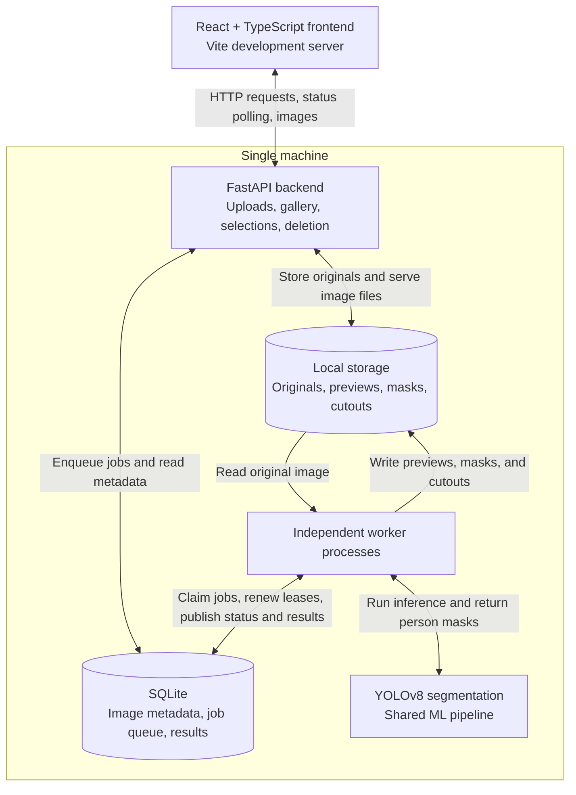

# Install dependencies

From the project root, install uv, Node.js, and FFmpeg using Homebrew, then install the project dependencies:

```sh
brew install uv node ffmpeg
uv sync --locked
npm --prefix frontend ci
```

# Start the backend

In a terminal at the project root:

```sh
uv run uvicorn backend.api:create_app --factory --host 127.0.0.1 --port 8000
```

# Start the worker

In a separate terminal at the project root:

```sh
uv run python -m backend.worker
```

# Start the frontend

In a separate terminal at the project root:

```sh
npm --prefix frontend run dev
```

Open http://127.0.0.1:5173/ in your browser.

# Architecture



An upload saves a full-resolution original and queues a job. Workers process jobs asynchronously while the frontend polls for completion. The API combines selected person masks into a mask or transparent cutout on demand, without running the model again.

# Key decisions Delong has made

## Features and scope

- Accept PNG and JPEG images, detect individual people, and let users select which people remain in the output.
- Provide a gallery and an image detail modal with original, mask, and cutout views. Support gallery pagination and full-resolution image retrieval through the API.
- Produce individual masks and cutouts for each detected person, as well as combined outputs for the selected people.
- Support image deletion, including associated job history and stored image files.
- Keep images at full resolution. Multiple resolution variants and mipmapping are deferred.
- General application usability: UX design, keyboard hotkeys, ...

## Architecture

- Use React, TypeScript, and Vite for the frontend, with a Python FastAPI backend and a separate ML worker.
- Start with YOLOv8 segmentation. Keep model-specific inference behind a shared result contract so a later model can replace it without changing the API or frontend contracts.
- Use SQLite for metadata and a durable job queue on one machine. Allow multiple worker processes on that machine; distributed workers are outside the current scope.
- Process uploads asynchronously. Persist job status, retry failed processing, and recover abandoned jobs after worker failures using expiring claims and heartbeats.
- Store image files on the local filesystem and metadata in SQLite.
- Use automated tests for the backend and ML pipeline. Verify the frontend manually, without frontend tests. AI generated frontend tests are usually bloated and bad

## Data model

The API and ML pipeline share a result contract. The frontend consumes that contract through API responses with image URLs.

| Record | Shared data and relationships |
| --- | --- |
| Image | UUID, filename, dimensions, upload time, and latest job reference. One image can have multiple jobs across retries. |
| Job | UUID, image reference, status, attempt count, errors, timestamps, and worker claim. States are `queued`, `processing`, `succeeded`, and `failed`. A manual retry creates a new job and preserves prior job history. |
| Segmentation result | Image dimensions, preview, combined mask, combined cutout, and a list of detected people. The job stores the published result as JSON. |
| Detected person | A 1-based index within its result, confidence, bounding box in source-image pixel coordinates, individual mask, and individual cutout. |

- Selections reference person indices within an image's current result. The frontend holds the selection; the API generates selected outputs on demand without persisting selection records.
- Keep test inputs together under `data`, tracked in Git with source metadata. Include both people and negative cases in the 20-image set.

# Potential follow-ups

## Improve image segmentation

### Manual mask refinement

- Add brush and eraser tools to the image detail view. This would require user interaction.  
- Provide Undo, Redo, and Reset.
- Add a mask-upload endpoint, such as `POST /api/images/{image_id}/cutout-from-mask`, for saving or exporting the adjusted cutout without rerunning ML.

### Larger models and higher-resolution inference

- Compare the current YOLOv8n baseline with larger segmentation models, starting with YOLOv8s.
- Compare results using a different segmentation model

